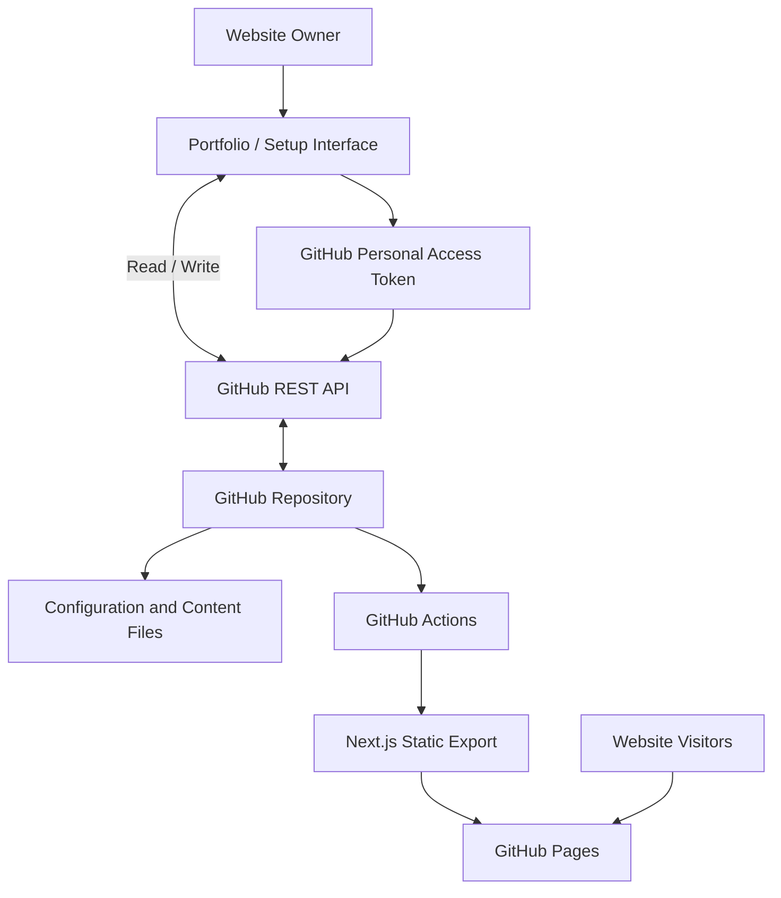

# Portfolio

A modern, configurable portfolio powered by **Next.js, GitHub, and GitHub Pages**.

A portfolio website that doubles as its own CMS. No application backend, no database, and no separate admin server. Manage your website through a built-in setup interface, with content stored directly in your GitHub repository and deployed as a static website.

Fork it, configure it, and publish your own portfolio for free.

## Table of Contents

- [Overview](#overview)
- [Features](#features)
- [How It Works](#how-it-works)
- [Getting Started](#getting-started)
- [Security and Access](#security-and-access)
- [Running Locally](#running-locally)
- [Technology Stack](#technology-stack)
- [Keeping Your Fork Up to Date](#keeping-your-fork-up-to-date)
- [Contributing](#contributing)
- [License](#license)

## Overview

This project started as a personal portfolio and evolved into a reusable portfolio platform with a built-in content management experience.

Rather than introducing a conventional backend and database just to manage website content, the application uses GitHub as its content store. Configuration, blog posts, and other content are maintained as files in the repository, while the built-in Setup interface provides a convenient way to manage them.

The result is a self-contained portfolio application that combines the flexibility of a CMS with the simplicity of static hosting.

## Features

### Portfolio pages

A collection of configurable pages to present your professional identity, experience, and work.

- **Home:** A personalized landing page with a cover image and introduction.
- **About:** An introduction, profile information, and key highlights.
- **Journey:** An interactive timeline of academic, professional, and personal milestones.
- **Projects:** Showcase projects with descriptions, images, external links, and key details.
- **Skills:** Present technical skills and associate them with relevant projects and milestones.
- **Services:** Describe services you offer and provide relevant links.
- **Testimonials:** Display recommendations and testimonials with author information.
- **Gallery:** Organize photographs into collections.
- **Blog:** Publish articles using a rich-text editing experience.
- **Quick Links:** Provide convenient access to downloadable resources and important links.

Individual pages and their content can be configured independently. The navigation menu can also be customized to show only the sections you want.

### Built-in content management system

The application includes a dedicated Setup interface for managing website content without manually editing configuration files.

Features include:

- Form-based configuration for individual portfolio sections.
- Dynamic management of projects, skills, milestones, testimonials, and other entries.
- Rich-text editing for blog posts.
- Configuration validation using Zod schemas.
- GitHub-backed file management.
- Image and asset selection from the connected repository.
- Automatic generation of stable identifiers for managed entries.
- Configuration migrations to accommodate changes in the application's data structure.

### GitHub as the CMS backend

The application uses GitHub as its content storage and management layer.

Instead of maintaining a separate backend, it communicates directly with the GitHub REST API through the browser.

The workflow is straightforward:

1. Connect your GitHub repository using a Personal Access Token.
2. Open the Setup interface.
3. Modify your website content.
4. Save your changes.
5. The application writes the updated configuration files directly to your repository.

Changes are committed to GitHub through its Contents API. The repository becomes the source of truth for your website's content.

**No custom API server, database, or application hosting infrastructure is required.**

### Static deployment

The application uses Next.js static export, making it suitable for GitHub Pages and other static hosting providers.

The deployment workflow automatically:

- Installs dependencies.
- Builds the application.
- Configures the appropriate GitHub Pages base path.
- Sets the canonical website URL.
- Generates the static deployment artifact.
- Publishes the website to GitHub Pages.

Once configured, you can redeploy your website whenever you need to.

### Automated repository maintenance

Forks include additional GitHub Actions workflows to simplify maintenance.

- **Upstream synchronization:** Automatically checks for upstream changes daily and can also be triggered manually.
- **Configuration preservation:** Preserves your fork's website configuration when synchronizing application updates.
- **Configuration migrations:** Automatically migrates configuration files when the application introduces newer configuration versions.
- **Image thumbnails:** Generates optimized thumbnails for uploaded images.

This allows your portfolio to benefit from upstream improvements without routinely having to rebuild it from scratch.

### SEO and discoverability

SEO is integrated into the application rather than being an afterthought.

Features include:

- Page-specific metadata and descriptions.
- Canonical URLs.
- Open Graph metadata for social sharing.
- Twitter card metadata.
- Structured data using Schema.org.
- Automatically generated sitemap.
- Robots directives.
- Web application manifest.
- Configurable website identity, keywords, and descriptions.

The deployment workflow automatically supplies the website's canonical URL, including the GitHub Pages base URL when applicable.

---

## How it works

The architecture deliberately uses GitHub as the persistence and content management layer.

> Want to understand the thinking and architectural decisions behind this project? Click [here](https://gauravnyaupane.com.np/blogs/i-built-a-portfolio-website-that-doubles-as-its-own-cms-no-backend-required/).



### Content management flow

The Setup interface communicates directly with GitHub's REST API.

Configuration is stored in JSON files, while rich-text blog content is maintained separately. The application reads and validates these files against their corresponding schemas.

When changes are saved, the application creates or updates the appropriate files in the connected repository.

### Deployment flow

GitHub Actions builds the application into a static website and publishes the resulting files to GitHub Pages.

The deployed website does not require an application server to execute its pages or manage visitor requests.

This separation keeps content management and public website delivery independent.

---

## Getting started

### 1. Fork the repository

Fork this repository:

[https://github.com/nightmaregaurav/portfolio](https://github.com/nightmaregaurav/portfolio)

Your fork will become the source repository for your personal website.

### 2. Configure GitHub Pages

In your fork:

1. Open **Settings → Pages**.
2. Set the deployment source to **GitHub Actions**.
3. Open the **Actions** tab.
4. Enable the repository workflows if GitHub asks you to.

### 3. Deploy your website

1. Open **Actions**.
2. Select **Deploy portfolio to GitHub Pages**.
3. Choose **Run workflow**.
4. Wait for the build and deployment to complete.
5. Open the website URL provided by GitHub Pages.

### 4. Configure your portfolio

Open the deployed website and navigate to the Setup area.

Connect your GitHub repository using a **GitHub Personal Access Token (PAT)**, then configure the available sections.

1. Create a [Fine-grained Personal Access Token](https://github.com/settings/personal-access-tokens/new).
2. Select the repository you want to connect.
3. Under **Repository permissions**, grant **Contents: Read and write** access. This permission is required because the CMS reads your configuration files and commits your changes directly to the repository.
4. Use the generated token to connect your repository through the Setup interface.

For more details, see GitHub's [documentation on managing fine-grained personal access tokens](https://docs.github.com/en/authentication/keeping-your-account-and-data-secure/managing-your-personal-access-tokens).

You can now use this token to manage your website's content through the Setup interface.

Save your changes to commit them directly to your repository.

Your website's content is now managed through its own built-in CMS.

### 5. Connect a custom domain (optional)

If you want to use your own domain:

1. Open **Settings → Pages** in your fork.
2. Configure your custom domain.
3. Complete the DNS configuration required by GitHub Pages.
4. Trigger a new deployment.

The deployment workflow uses the configured GitHub Pages URL when generating canonical URLs and SEO metadata.

---

## Security and access

The Setup interface requires a GitHub Personal Access Token to interact with the connected repository.

For security:

- Use a fine-grained Personal Access Token.
- Restrict the token to the repository you want to manage.
- Grant only the permissions required for repository content management.
- Do not commit your token or expose it in source code.
- Revoke the token if you suspect it has been compromised.

The token is stored in the browser's local storage and is used by the browser to communicate with GitHub directly. It is not stored in an application backend.

For additional information, see [SECURITY.md](SECURITY.md).

---

## Running locally

You can also run the application locally for development and customization.

### Prerequisites

| Dependency | Version |
|---|---|
| Node.js | `26.13.0` |
| pnpm | `12.18.0` |

### Installation

Clone your fork:

```bash
git clone https://github.com/YOUR_USERNAME/portfolio.git
cd portfolio
```

Install dependencies:

```bash
pnpm install
```

Start the development server:

```bash
pnpm dev
```

Open [http://localhost:3000](http://localhost:3000).

### Local configuration

The application supports a `local-config/` directory for development-only configuration.

When running in development mode, files in this directory override the corresponding files in `public/config/`.

This allows you to experiment with configuration changes without modifying the tracked configuration files.

The `local-config/` directory is ignored by Git and should never be committed.

### Available scripts

| Command | Description |
|---|---|
| `pnpm dev` | Start the development server. |
| `pnpm build` | Generate the static production build. |
| `pnpm start` | Start the Next.js production server. |
| `pnpm lint` | Run ESLint. |
| `pnpm migrate-config` | Migrate configuration files to their latest supported versions. |
| `pnpm migrate-config:dev` | Run configuration migrations in development mode. |

---

## Technology stack

The project uses a modern React and TypeScript ecosystem.

| Technology | Purpose |
|---|---|
| [Next.js](https://nextjs.org/) | Application framework and static site generation. |
| [React](https://react.dev/) | Component-based user interface. |
| [TypeScript](https://www.typescriptlang.org/) | Type-safe application development. |
| [Tailwind CSS](https://tailwindcss.com/) | Utility-first styling. |
| [Base UI](https://base-ui.com/) | Accessible UI primitives. |
| [TanStack Query](https://tanstack.com/query) | Client-side data fetching and mutations. |
| [React Hook Form](https://react-hook-form.com/) | Form state management. |
| [Zod](https://zod.dev/) | Configuration and form validation. |
| [Tiptap](https://tiptap.dev/) | Rich-text editing. |
| [GitHub REST API](https://docs.github.com/en/rest) | Content storage and management. |
| [GitHub Actions](https://github.com/features/actions) | Automated builds, deployments, and maintenance. |
| [GitHub Pages](https://pages.github.com/) | Static website hosting. |

---

## Keeping your fork up to date

Your fork includes an automated upstream synchronization workflow.

It periodically checks the original repository for updates and merges upstream changes into your fork.

Website configuration is preserved during synchronization, while application updates are incorporated.

You can also trigger the synchronization manually through:

**Actions → Sync Fork with Upstream → Run workflow**

Configuration migrations are subsequently triggered to keep your existing content compatible with newer application versions.

If you make substantial modifications to the application's source code, review upstream changes carefully before relying on automatic synchronization.

---

## Contributing

Contributions, improvements, and bug reports are welcome.

Before contributing, please read [CONTRIBUTING.md](CONTRIBUTING.md).

---

## License

This project is distributed under the **Personal Use, Attribution, Non-Commercial License**.

See [LICENSE](LICENSE) for the complete terms.

---

With love, **[Gaurav Nyaupane](https://github.com/nightmaregaurav)**

[Original Repository](https://github.com/nightmaregaurav/portfolio)
